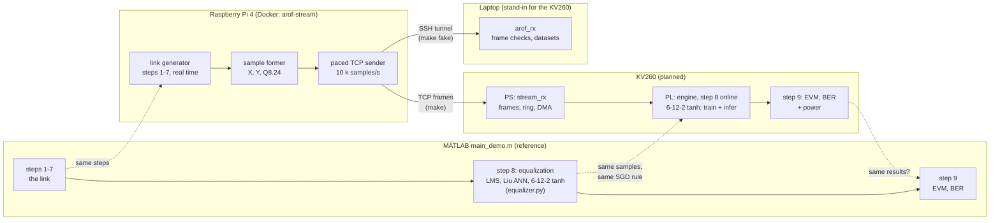
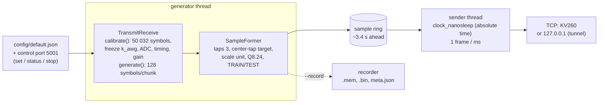
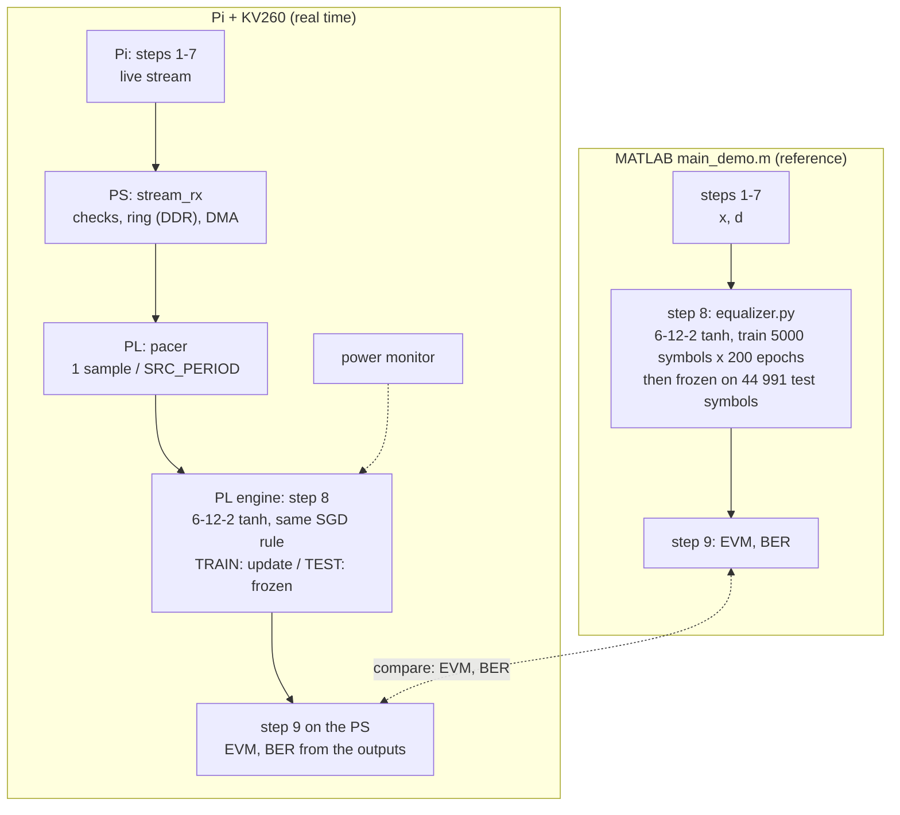
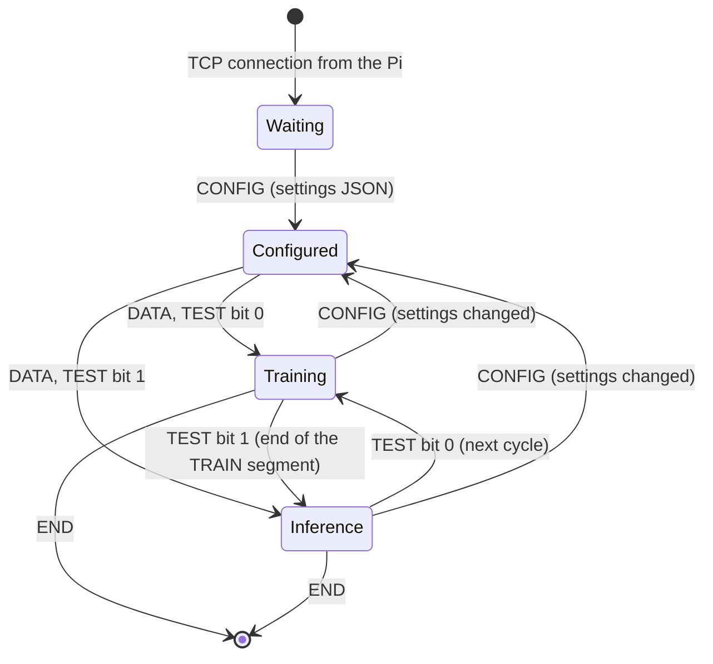

```mermaid
flowchart LR
    subgraph CO["Central office"]
        S["16QAM symbols<br/>0.4 GBd"] --> RRC["RRC shaping<br/>0.75 roll-off"] --> IF["IF 0.8 GHz<br/>AWG 300 mVpp"]
        IF --> DRV["driver amp<br/>G 24, Rapp"] --> MZM["MZM<br/>Vpi 4.4 V"]
    end
    subgraph FIB["Fiber"]
        F["15 km SMF<br/>dispersion"]
    end
    subgraph RAU["Remote antenna unit"]
        PD["photodetector<br/>heterodyne 60 GHz<br/>PD noise"] --> PA["RF amp<br/>AGC, Rapp"] --> RIP["RF response"]
    end
    subgraph AIR["Wireless"]
        W["1 m, FSPL 68 dB<br/>UE noise (LNA)"]
    end
    subgraph UE["User equipment + DSP"]
        DET["envelope detector<br/>square law, 1.5 GHz"] --> ADC["ADC 8 bit"]
        ADC --> DSP["down-convert<br/>matched filter<br/>timing, gain"]
    end
    MZM --> F --> PD
    RIP --> W --> DET
    DSP --> OUT["received symbols x(k)<br/>+ sent symbols d(k)"]
```

# A-RoF link on the Raspberry Pi, equalized online on the KV260

`main_demo.m` runs the whole experiment in MATLAB:
- **steps 1–7:** the 60-GHz analog radio-over-fiber link of Liu et al. (JLT 2017);
- **step 8:** the equalizers, with the neural networks trained by `matlab/equalizer.py`;
- **step 9:** EVM and BER.

This project runs the same experiment **in real time** on hardware. The data is generated live
and streamed; the receiver also captures it as datasets in the layout of `export_dataset.m`,
which MATLAB still exports for reference and offline processing.
- **The Raspberry Pi** runs steps 1–7 as an endless real-time stream. It turns each received
  16QAM symbol into a sample (inputs and target) and sends it over TCP to the KV260.
- **The KV260** does step 8 **online**, on the live stream: its engine trains the 6-12-2 tanh
  equalizer of the MATLAB study and equalizes the symbols as they arrive. Then it does step 9.
  The aims are to **reproduce the results of `main_demo.m`'s equalization on the FPGA**, and to
  **measure the power** this takes.
- **A laptop** can stand in for the KV260 (`host/`).

This is the project's reference document. The step-by-step comparison with MATLAB (each step's
code, its C++ twin and its checks) is in [matlab_mirror/](matlab_mirror/README.md). Integrating
the repository into the main project (MATLAB, RTL, `nn_training_model`) is described in
[INTEGRATION_HANDOFF.md](INTEGRATION_HANDOFF.md).

Contents:
1. The system
2. The communication link and the DSP chain
3. The Pi's steps and their MATLAB counterparts
4. Inside the Pi: calibration, threads, settings
5. From received symbols to samples
6. The frame structure and the control port
7. Step 8 online on the KV260
8. The KV260 frame by frame
9. How it mirrors MATLAB
10. Running it
11. How close the Pi is to MATLAB
12. Decisions and open points

## 1. The system



| Part | Role | Status |
|---|---|---|
| MATLAB `main_demo.m` | The reference experiment: steps 1–7 (the link), 8 (equalizers, `equalizer.py`), 9 (EVM, BER) | Reference copies in [reference/](../reference/) |
| Raspberry Pi, `arof_stream` in Docker | Runs steps 1–7 in real time, forms the samples, streams them at a fixed rate | Done and verified |
| Laptop, `host/arof_rx` | Receives through an SSH tunnel, checks every frame, saves each cycle as a dataset | Done |
| KV260, `stream_rx` + engine | Step 8 online on the live stream (train and infer the 6-12-2 tanh), step 9, power measurement | Planned (section 7) |

## 2. The communication link and the DSP chain

The physical link of Liu et al.:
1. A central office drives a Mach-Zehnder modulator.
2. The optical signal crosses 15 km of fiber.
3. A remote antenna unit turns it into a 60-GHz radio signal.
4. The radio signal crosses 1 m of air to the user equipment.

The Pi simulates each block with the formula of the MATLAB module of the same name.



At 300 mV and −11.75 dBm:
- the CNR is 33.5 dB at the photodetector (37 dB at −10 dBm, 2 dB per dB of ROP) and 42.0 dB at
  the UE (link budget: 59.7 GHz, FSPL 68.0 dB over 1 m);
- the driver output is 5.44 Vpp against Vπ = 4.4 V, deep into the MZM's sine;
- the no-EQ EVM is 13.3 %.

About 12 % of that EVM is distortion (with every noise source off the EVM is 12.07 %): the MZM,
the chirp the fiber turns into intensity, and the PA. An equalizer can partly undo it; the rest
is noise.

## 3. The Pi's steps and their MATLAB counterparts

Every step uses the same logic and the same formulas as `main_demo.m`; `src/link/` has one
module per `matlab/link/*.m` function, with MATLAB's parameter names. The Pi differs only where a
stream has to:
- **Whole-sequence statistics:** where MATLAB takes a statistic over the whole sequence, the Pi
  measures it once on a calibration block of the same size and then freezes it (section 4).
- **Random numbers:** the Pi uses its own generator, so results agree statistically, not sample
  for sample.

Each step in detail: [matlab_mirror/](matlab_mirror/README.md).

| Step | MATLAB | Pi (`src/`) | Difference on the Pi | Verified |
|---|---|---|---|---|
| 0 Settings | `default_tx.m`, `default_link.m`, `experiment_setup.m` | `link/default_*`, `core/link_settings.*`, `config/default.json` | Settings in JSON, changeable live; the impairment switches applied as `impairment_sweeps.m` | Default link equals `default_link.m` field by field |
| 1 Transmitter | `randi`, `qammod`, `upfirdn` (RRC 0.75, 801 taps), IF 0.8 GHz, AWG `vpp/(max(v)−min(v))` | `link/transmitter.*`, `core/comm.*` | AWG gain `k_awg` from the calibration block | Matches `upfirdn` to 1e-14 |
| 2 Driver + MZM | `driver_amp.m` (G 24, Rapp vsat 3 V), `mzm.m` | `link/driver_amp.h`, `link/mzm.h` | None (memoryless) | 1e-14; bias-drift sweep, e.g. 16.02 % at 0.1·Vπ (MATLAB 16.08 %) |
| 3 Fiber | `fiber.m`: one FFT, `exp(jβ2/2·ω²L)` | `link/fiber.*`: overlap-save, nfft 8192, ±128 taps | The impulse response is truncated: error 1.9e-5 of the signal rms at 15 km, 1.3e-4 at 100 km (PD noise is ~2e-2) | Fiber sweep, e.g. 13.40 % at 100 km (MATLAB 13.45 %) |
| 4 Remote antenna unit | `photodetector.m` (RIN, saturation, PD noise), `carrier_noise.m`, `rf_amp.m` (AGC, Rapp 1.3·a0, memory), `rf_response.m` (echo 1 ns) | `link/photodetector.*`, `carrier_noise.h`, `rf_amp.*`, `rf_response.*` | One random stream per noise source: switching RIN on leaves the PD noise unchanged (in MATLAB it doesn't) | Noise power within 1 %; RIN, PD saturation, PA memory, ripple sweeps within tolerance |
| 5 Wireless hop | `wireless_hop.m` | `link/wireless_hop.*` | None | CNR equals the budget to 1e-12 |
| 6 Detector + ADC | `envelope_detector.m` (`|A|²`, 1-pole 1.5 GHz), `adc.m` (8 bits over min…max, optional clipping) | `link/envelope_detector.*`, `link/adc.*` | ADC range (and mean, std for clipping) from the calibration block; samples beyond it saturate at codes 0 and 255 | Filter to 1e-14; ADC clipping sweep, e.g. 19.22 % at 1.0 (MATLAB 19.27 %) |
| 7 Receiver DSP | `conv` (down-convert, matched filter), timing search over 51 offsets, LS complex gain | `link/receiver.*` | `mean(r)`, timing, gain from the calibration block; matched filter only at the symbol instants | 13.21 % at the reference point (MATLAB 13.21 %) |
| 8 Equalization | `run_lms.m`, networks (`equalizer.py`) | **Not on the Pi**: done online on the KV260 (section 7) | `tools/run_lms.py` as an offline check | LMS 12.80 % on Pi data (MATLAB 12.81 %) |
| 9 Evaluation | `evaluate_outputs.m` | `core/evaluate_outputs.*`, `tools/evaluate_outputs.py` | Scores the calibration block only; on the KV260, scores the engine's outputs | Same rules (44 991 test symbols, τ = 5) |
| The chain as a stream | `transmit_receive.m` | `link/transmit_receive.*` | Calibrate once, then generate forever; state carried across blocks | Same stream for any block size, bit for bit |
| Samples | Built in step 8 by `equalizer.py`; exported by `export_dataset.m` | `stream/*` | The samples as an endless TCP stream | Byte-identical words (section 11) |

## 4. Inside the Pi: calibration, threads, settings



**Calibration** (`TransmitReceive::calibrate()`, one MATLAB run, about 2.1 s on the Pi 4):
1. A block of `n_sym + 2·guard` = 50 032 symbols through the transmitter; `k_awg` from its
   max − min.
2. The channel over the block, plus a tail of 182 symbols so the fiber's held-back samples
   (up to 8192) come out.
3. The ADC range from the block.
4. `mean(r)`, timing and gain on the training symbols `guard + (1:5000)`, as step 7.
5. The block through the receiver, scored as `main_demo.m` scores no EQ.

The block is not streamed. After it, `generate()` continues the same sequence with these
constants frozen; every stage carries its state (RRC history, fiber overlap, PA and ripple delay
lines, detector, receiver history) so the stream is one continuous sequence.

**Threads** (`src/stream/streamer.*`):
- **Generator:** 128 symbols per chunk → samples → a single-producer single-consumer ring,
  kept at least 1 s and 1.5 × the calibration time ahead, so a recalibration does not starve the
  sender. Control requests are applied between chunks.
- **Sender:** paced on absolute time (`clock_nanosleep`, `TIMER_ABSTIME`), one frame per
  `frame_ms`; each tick sends `floor(rate · elapsed) − sent` samples, so the rate never drifts.
  Optional `SCHED_FIFO`. Samples not ready in time are counted (`late_samples`); beyond 0.1 s
  behind, the clock re-anchors (`slips`). It reconnects if the receiver goes away; a frame lost
  that way is counted (`lost_samples`) and `first_sample` still advances.
- **Control:** TCP port 5001, one JSON line per command (section 6).

**Live changes:** a `set` that changes the link or the operating point reconfigures the stages
and recalibrates (new `config_id`, CONFIG and RECALIBRATED frames). The time axis and the symbol
count continue. With `rx.freeze_rx` the receiver side (ADC range, `mean(r)`, timing, gain) is
kept, as a receiver that does not know the link changed. `fiber.enable` and the `samples` section
are startup-only.

**Random numbers:** four xoshiro256++ streams (symbols, RIN, PD noise, UE noise), seeded from
`seed`; normals by ziggurat. The same seed gives the same stream bit for bit.

**Settings** (`config/default.json`):

```json
{
  "link": { "vpp_mv": 300, "rop_dbm": -11.75, "fiber_m": 15000,
            "bias_drift": 0, "rin_dbhz": "-inf", "pd_sat": "inf",
            "pa_memory": 0, "ripple_rho": 0, "adc_clip": "inf" },
  "rx":   { "freeze_rx": false, "calib_symbols": 50000, "train_symbols": 5000 },
  "samples": { "taps": 3, "scale": "unit", "schedule": "demo" },
  "stream": { "rate_sps": 10000, "frame_ms": 1, "host": "192.168.1.10", "port": 5000,
              "control_port": 5001 },
  "seed": 2017,
  "record": { "enable": false, "dir": "/records", "max_samples": 49991 }
}
```

`"link"` holds `main_demo.m`'s section 0 switches with the same names and "off" values (`"inf"`,
`"-inf"` as strings). An optional `"stages"` section overrides any field of `default_link.m` by
its MATLAB name, e.g. `{"stages": {"pd": {"cnr_db": 40}}}`, and `"tx"` any field of
`default_tx.m`. `samples.train_len` / `test_len` set the schedule's block lengths
(5000 / 44 991).

## 5. From received symbols to samples

Each received symbol becomes one sample, as soon as it is generated. The samples are exactly the
ones `matlab/equalizer.py` (model `'real'`) builds in `main_demo.m` step 8 for the network the
hardware targets: the 6-12-2 tanh of the MATLAB study (`own_tanh_6`: 3 taps, 12 hidden units,
tanh, 2 linear outputs, lr 1e-2, 200 epochs).

```
X = [ Re x(k)  Im x(k)  Re x(k-1)  Im x(k-1)  Re x(k-2)  Im x(k-2) ]   6 inputs: 3 received symbols, newest first
Y = [ Re d(k-1)  Im d(k-1) ]                                         2 targets: the symbol sent at the center tap
```

- **Center-tap target:** the network predicts the middle symbol of its window
  (`delay = floor(taps/2) = 1`), as `equalizer.py` does (`t[k - taps // 2]`). It sees one symbol
  after the target and one before it, so it can undo interference from both sides.
- **Scale "unit":** 16QAM normalized to unit average power (levels ±1/√10, ±3/√10), as
  `equalizer.py` uses for sigmoid and tanh networks. `grid` (×√10, levels ±1, ±3) stays
  available for the multilevel networks.
- **Q8.24:** each value as `nearbyint(float32(v) · 2^24)`, saturated to int32: the engine's
  number format and `nn_training_model`'s `to_q`. A sample is 8 words (32 bytes).
- **Taps setting:** with `taps = T`, a sample has `2T + 2` words and the target is
  `d(k − floor(T/2))`. `taps 2` (6 words) fits today's 4-12-2 engine.
- **Schedule:** which samples are TRAIN and which are TEST (section 7).
  - `demo` (default) follows `main_demo.m`: 5000 TRAIN samples, then 44 991 TEST samples,
    repeating. In `equalizer.py` the training windows are k = 6 … 5005 and the test windows
    k = 5006 … 49 996 (MATLAB 1-based), back to back.
  - `train`: every sample is TRAIN, for pure online training scored prequentially. Periodic TEST
    blocks can be added when that experiment is designed.
- **The dataset:** one `demo` cycle, 49 991 samples (5000 train + 44 991 test), is the dataset of
  the project, in MATLAB and on the hardware. It is the training and test set of `main_demo.m`
  step 8, where the 6-12-2 tanh beat LMS (BER 5.6e-6 against 1.1e-5); 44 991 test symbols
  (179 964 bits) are needed to measure BER in that range. `host/arof_rx` saves each complete
  cycle in the layout of `export_dataset.m` (`dataset.mat`, train and test `.mem` files), and so
  does the Pi's `--record` (with `tools/export_dataset.py`).

Dataset fields (`export_dataset.m`, `reference/arof_training_data.mat`): `X` (N×6), `Y` (N×2,
double), `rx_aligned`, `tx_aligned`, `tx_symbols`, `tx_indices`, `tx_bits`, `mod_order`,
`bits_per_symbol`, `delay` (1), `equalizer_taps` (3), `equalizer_input_size` (6),
`equalizer_output_size` (2), `scale` (`'unit'`), `vpp_mv`, `rop_dbm`, `seed`, `evm_no_eq`,
`source`. In a dataset rebuilt from the stream (`arof_rx`), the symbol fields have one entry per
sample (the center-tap symbol), because the stream carries the sent point only at the center
taps; a `--record` export has all N + T − 1 symbols, as MATLAB.

## 6. The frame structure and the control port

One TCP connection, Pi (client) → receiver (server, port 5000), little-endian. Every frame starts
with a 36-byte header ([src/stream/frame.h](../src/stream/frame.h)):

```
 0               4       6       8               12                              20
 +---------------+-------+-------+---------------+-------------------------------+
 | magic "AoRF"  |version| flags |      seq      |          first_sample         |
 | 0x46526F41    |   1   |       |  frame count  |   index of the first sample   |
 +---------------+-------+-------+---------------+-------------------------------+
 20              24      26      28              32              36
 +---------------+-------+-------+---------------+---------------+
 |   n_samples   |  wps  | rsvd  |   config_id   |     seed      |
 +---------------+-------+-------+---------------+---------------+
```

| Flag | Bit | Meaning |
|---|---|---|
| RECALIBRATED | 0 (1) | First data frame after a settings change |
| TEST | 1 (2) | The frame's samples are TEST: infer only, no weight update |
| END | 2 (4) | Last frame: the generator stopped |
| CONFIG | 3 (8) | The payload is JSON: the full settings and calibration |

Three kinds of frame:

```
CONFIG:  [header: flags 8, n_samples = JSON bytes, wps 0] [ JSON text ...................... ]
DATA:    [header: flags 0 or 2, n_samples 10, wps 8    ] [ sample 0: 8 words ][ sample 1 ] ... [ sample 9 ]
END:     [header: flags 4, n_samples 0                 ]
```

Each sample's 8 words:

```
 word:   0         1         2           3           4           5          | 6          7
         Re x(k)   Im x(k)   Re x(k-1)   Im x(k-1)   Re x(k-2)   Im x(k-2)  | Re d(k-1)  Im d(k-1)
         └──────────────────── X: network input ──────────────────────────┘   └── Y: target ──┘
 e.g.    FEF529E0  005D933F  FF1B6C57    FF2EFF5E    007D5E47    FF975A2C   | FF0D2317   FF0D2317
         -1.0423   0.3655    -0.8929     -0.8164     0.4897      -0.4088    | -0.9487    -0.9487
```

In this example the target, −3/√10 = −0.9487 on both I and Q, is the center tap, close to the
received value there, x(k−1) = −0.89 − 0.82j.

The stream in time (schedule `demo`, 10 k samples/s, 1 frame per ms):

```
 CONFIG  DATA DATA ... DATA | DATA ........ DATA | DATA ... DATA | DATA ........ DATA | ...   (CONFIG + RECALIBRATED
         └─ 5000 TRAIN ───┘ └─ 44 991 TEST ────┘ └─ 5000 TRAIN ┘ └─ 44 991 TEST ────┘        after a settings change)
         first_sample 0     5000                 49 991          54 991
         ◄─────────── cycle 0: about 5 s ──────► ◄─────────── cycle 1 ───────────►
```

- **No mixed frames:** a frame never mixes TRAIN and TEST samples, so the TEST bit applies to the
  whole frame.
- **Cycle boundaries:** `first_sample` is the generator's sample index (also across reconnects),
  so a cycle starts where `first_sample % 49991 == 0`; the receiver finds the boundaries without
  a marker.
- **Settings changes:** a CONFIG frame opens every connection and announces every change. The
  first data frame after a change carries RECALIBRATED and the new `config_id`. Samples already
  in the ring (up to ~3.4 s) are sent with the old `config_id`.
- **CONFIG payload length:** `n_samples` holds the JSON byte count and `words_per_sample` is 0.
- **Bandwidth:** about 0.36 MB/s at 10 k samples/s (32-byte samples, 36-byte headers), about 2.6 MB/s at 80 k.

**Control port** (5001 on the Pi, one JSON line in, one JSON line back):

```
{"set": {"link": {"rop_dbm": -13}}}      any setting; link changes recalibrate
{"set": {"stream": {"rate_sps": 20000}}} rate change, no recalibration
{"status": {}}                           rates, late samples, slips, reconnects, lost samples, last calibration
{"stop": {}}                             END frame, exit
```

## 7. Step 8 online on the KV260: reproducing main_demo's equalization



### The reference: main_demo.m step 8

All the network results of the MATLAB study come from `matlab/equalizer.py`, in float64, called by
`core/run_network.m`. Its `'real'` model trains with the engine's rule: per-sample SGD,
back-propagation with the pre-update weights, no restarts. `main_demo.m` step 8 trains every
equalizer on the first 10 % of a 50 000-symbol sequence and tests on the rest (44 991 symbols).
EVM and BER are reported together, because a staircase activation can lower EVM without reducing
the wrong decisions.

| Equalizer (one sequence, 300 mV, −11.75 dBm) | EVM | BER |
|---|---|---|
| No EQ | 13.3 % | 1.1e-4 |
| LMS FFE, 10 taps | 12.9 % | 1.1e-5 |
| Liu ANN (replicated) | 15.3 % | 6.1e-5 |
| **6-12-2 tanh (hardware target)** | 11.3 % | 5.6e-6 |
| 10-12-2 multilevel | 6.6 % | 1.1e-5 |

In the impairment study (validation data, 6 conditions × 3 runs), the 6-12-2 tanh had the best
mean BER of all candidates and beat LMS in most conditions. One sequence is not enough to claim
it beats the Liu replica; that comparison over 6 runs is still to be done in MATLAB.

### What the KV260 does, in real time

1. **Receive.** `stream_rx` on the PS checks the frames as they arrive, puts the samples in a ring
   in DDR (u-dma-buf, 16 MB, prefill 200 ms) and DMAs them to the PL in chunks.
2. **Pace.** A pacer in the PL (a FIFO of whole samples, 512 deep) releases one sample every
   `SRC_PERIOD = 100 MHz / rate` cycles: the exact clock comes from the PL, not from the network.
3. **Train and equalize.** The engine is the 6-12-2 tanh: 3 taps → 6 inputs, 12 hidden units,
   2 outputs. For each sample it computes its output and compares it with the target `Y`.
   - **TRAIN frame:** it updates its weights with the same SGD step as `equalizer.py`.
   - **TEST frame:** it does not update (inference only). Its output is the equalized symbol, and
     its error is a test error.
4. **Evaluate (step 9).** The PS reads the outputs and computes EVM and BER as
   `core/evaluate_outputs.m` does.
   - TEST outputs give the same numbers as `main_demo.m`'s test set.
   - Each TRAIN output is computed before the update on its own sample, so it also predicts an
     unseen symbol (prequential evaluation).

The Pi never equalizes: its output stops at step 7, as the KV260's input.

### Following main_demo.m's protocol on the live stream (schedule `demo`)

`main_demo.m` trains the 6-12-2 tanh for 200 epochs over its 5000 training symbols, 1 M updates,
then freezes it for 44 991 test symbols. On the live stream:

- **Training.** The 5000 TRAIN samples arrive in real time (0.5 s at 10 k samples/s).
  `stream_rx` keeps them in DDR and replays them to the engine 200 times, as `equalizer.py` repeats
  its training symbols. Replay is unpaced, as fast as the engine trains: about 85 k updates/s for
  today's 4-12-2, roughly a third fewer for the 6-12-2 (more MACs per update), so about 12–16 s.
  The learning rate is 1e-2, as in the study.
- **Test.** The following 44 991 TEST samples are equalized live as they arrive, at the fixed
  clock, with the weights frozen, and are scored. Samples that arrive during the replay wait in
  the DDR ring (well under 16 MB).
- **Pure online training (schedule `train`).** Each new sample trains the engine once, with no
  replay, as a real receiver adapts. This is the next experiment, and its learning rate may need
  retuning.

### Comparing with MATLAB

1. **Statistical.** The Pi's random numbers differ from MATLAB's, so the board's EVM and BER are
   compared with `main_demo.m`'s within their spread. At BER 5.6e-6 a cycle has about one bit
   error, so BER is averaged over many cycles. All cycles of one run share one receiver
   calibration; restart with another `seed` for independent runs.
2. **Engine arithmetic.** The engine works in Q8.24, `equalizer.py` in float64, and a hardware
   tanh is an approximation. Once `nn_training_model` models the 6-12-2 tanh (a tanh activation
   and a 6-input RAM map), it reproduces the engine's arithmetic exactly; differences against
   MATLAB can then be attributed. This is an important step before the RTL change.

### Power measurement

The KV260 also measures the power that real-time equalization takes, on the real board:

| State | What runs |
|---|---|
| Idle | Bitstream loaded, no stream |
| Receiving only | `stream_rx`, DMA and pacer, engine idle |
| Training | Replay of the TRAIN samples, engine updating |
| Equalizing | Live TEST stream, inference at 10 k samples/s (and at higher rates) |

**Sources:**
- an external meter on the 12 V input: the whole board, the most reliable total;
- the board's own telemetry, such as `xmutil platformstats` or the hwmon sensors (which rails it
  reports is to be confirmed on the board);
- Vivado's post-implementation power report: an estimate for the PL alone, to explain the
  measurements, not to replace them.

**Reported:** watts per state; the increase over idle for training and for inference; energy per
training update and per equalized symbol (that increase divided by the rate), each alongside the
EVM and BER reached. The `demo` schedule alternates the training and inference phases by itself.
The Pi's power is not part of it: the Pi plays the link.

**Until the engine has the 6-12-2 tanh,** the stream can run with `taps 2` (6 words per sample)
for today's 4-12-2 sigmoid engine, to test the path and measure power. Its results are not
comparable with earlier 4-12-2 runs, which used the newest symbol as target.

## 8. The KV260 frame by frame

What the KV260 does with each frame it receives (planned). `stream_rx` on the PS reads every
header; the engine in the PL sees only samples and a mode.



| Frame received | `stream_rx` (PS) | Engine (PL) |
|---|---|---|
| CONFIG | Parse the JSON: taps (8 words per sample for the 6-12-2 tanh, 6 for today's 4-12-2), schedule, rate → `SRC_PERIOD`, link settings; save it with the results; log the `config_id` | Nothing yet |
| DATA, TEST bit 0 (TRAIN) | Check `seq` and `first_sample`; samples into the DDR ring. Schedule `demo`: keep them and replay them 200 times. Schedule `train`: DMA → pacer directly | Forward pass, compare with `Y`, **update the weights**. The output, computed before the update, is a prequential test |
| DATA, TEST bit 1 (TEST) | As above, paced; set infer mode (`STREAM_CTRL`) for these samples; read the outputs for step 9 | Forward pass and error against `Y`, **weights frozen**: the equalized symbols, test EVM and BER |
| DATA with RECALIBRATED | Log the `config_id` change with the PROCESSED count: the channel changed here | Goes on training: the loss rises, then recovers |
| END | Drain the ring, stop | Stop after the last sample |
| A gap in `seq` or `first_sample` | Count it: a valid run has none | — |
| The pacer has no sample when due | — | Count `UNDERRUN`: the Pi or the network fell behind |
| The engine is slower than the clock | — | Drop and count `DROPPED` (0 below the engine's rate) |

## 9. How it mirrors MATLAB

The same experiment in two worlds: `main_demo.m` in MATLAB, and the Pi with the KV260 in real time.

| Stage | MATLAB (`main_demo.m`) | Pi + KV260 (real time) |
|---|---|---|
| Link, steps 1–7 | Inline in `main_demo.m` (= `link/transmit_receive.m`) | Pi: `src/link/*`, the same modules, generated live |
| Samples | Built by `equalizer.py` from x and d: 3 taps, center-tap target, unit power | Pi: `src/stream/sample_former.*`, the same samples, streamed |
| Number format | float64 | Q8.24, round half to even (Pi: `to_q8_24`) |
| Step 8, network | `equalizer.py`, 6-12-2 tanh, lr 1e-2 | The engine on the PL (6-12-2 tanh after the RTL change; 4-12-2 sigmoid today) |
| Step 8, protocol | Train 5000 symbols × 200 epochs, test 44 991 frozen | Schedule `demo`: the same on the live stream; `train`: pure online training |
| Dataset | `analysis/export_dataset.m` (reference, offline): 3 taps, center tap, unit power | Each `demo` cycle captured by `host/arof_rx` (and the Pi's `--record`): 49 991 samples in the same layout |
| Step 8, baseline | `core/run_lms.m` | `tools/run_lms.py` (offline check) |
| Step 9 | `core/evaluate_outputs.m`: EVM, BER on the test symbols | EVM, BER of the engine's TEST outputs (and prequential on TRAIN) |
| Engine arithmetic | — | `nn_training_model` (6-12-2 tanh: later step) |
| Power | — | Measured per state (section 7) |
| Settings change | A new run | A CONFIG frame + RECALIBRATED, without stopping |

## 10. Running it

On the Pi (`~/dev/arof-rt-generator`):

| Command | What |
|---|---|
| `make` | Build the image if needed (only when `src/`, `tests/`, `config/` or `CMakeLists.txt` changed), stream to the receiver in `config/default.json` (the KV260); `HOST=ip [PORT=n]` overrides it |
| `make fake` | Stream to `127.0.0.1`, through the SSH tunnel to the laptop |
| `make status` | Is the streamer container up: uptime, CPU, memory, its last log lines |
| `make tunnel-close` | Free port 5000 held by a stale tunnel (sudo) |
| `make build`, `make test` | Native build and the unit tests |

On the laptop (`host/`, Fedora: `make deps` once for g++, nlohmann json, matio, Wireshark):

| Command | What |
|---|---|
| `make` | Build `arof_rx`, open the SSH tunnel (`ssh -R`, in the background), receive 10 cycles (about 50 s), check every frame, save each cycle as a dataset, close the tunnel |
| `make CYCLES=60 DURATION=0` | 60 cycles (about 5 minutes) |
| `make verify` | Re-check the latest capture from its `stream.raw` |
| `make wireshark` | Wireshark on `lo`, `tcp port 5000` (start it before `make`) |

Each capture (`host/captures/<time>/`) holds `stream.raw`, `samples.bin`, `flags.bin`,
`configs.json`, `summary.json`, and one `cycle_NNN/` per complete cycle with `dataset.mat`
(written with matio) and `train_samples_q8_24.mem` (5000 samples) / `test_samples_q8_24.mem`
(44 991). A cycle broken by a gap or a settings change is dropped.

The binary and the tools directly:

```
arof_stream --calibrate                    # the link as main_demo.m prints it (no EQ, 44 991 test symbols)
arof_stream --record DIR [--samples N]     # a recording (default one demo cycle), no network
arof_stream --bench 15                     # generation rate of this machine
arof_stream --set '{"link": {"rop_dbm": -13}}' ...   # any setting from the command line

python tools/export_dataset.py DIR out.mat            # recording -> export_dataset.m layout
python tools/evaluate_outputs.py DIR_OR_MAT           # no EQ and LMS FFE, as main_demo.m steps 8-9
python tools/compare_matlab.py --set all [--lms]      # against the MATLAB study's results
python tools/fake_kv260.py --port 5000 [--save F]     # receiver stand-in: checks frames, rate, jitter
python tools/fake_kv260.py --file stream.raw          # the same checks on a saved stream, samples decoded
```

The Python tools need numpy and scipy (`python -m venv .venv && .venv/bin/pip install numpy scipy`).
A native build needs a C++17 compiler, CMake ≥ 3.20, pkg-config and FFTW 3; nlohmann/json is
fetched if not installed. The Docker image (arm64, `debian:bookworm-slim` pinned by digest,
`-mcpu=cortex-a72`; `MCPU=cortex-a76` for a Pi 5) runs the C++ tests in its build stage and runs
with `--network host --cpus 3 --cap-add SYS_NICE`.

## 11. How close the Pi is to MATLAB

| Check | Pi | MATLAB |
|---|---|---|
| No-EQ EVM, 300 mV, −11.75 dBm (6 seeds) | 13.19 %, BER 7.5e-5 | 13.21 %, 7.2e-5 |
| Study points: ROP and Vpp sweeps, 7 impairments (`compare_matlab.py --set all`) | 74 of 74 within tolerance (EVM 2.5 %, BER factor 2) | `compare_results.mat`, `impairments_results.mat` |
| LMS on Pi data | 12.80 % | 12.81 % |
| 50 000 symbols recorded in Docker, scored as `main_demo.m` | no EQ 13.3 % / 1.06e-4, LMS 12.9 % / 2.2e-5 | 13.3 % / 1.1e-4, 12.9 % / 1.1e-5 |
| A recording exported in the layout of `arof_training_data.mat` (3 taps, center tap, unit) | Same fields, classes, columns, delay, scale; no EQ 13.27 %, LMS 12.86 % | Reference dataset: 13.38 %, 13.04 % |
| Q8.24 words | Identical to `nn_training_model`'s `to_q` (fixture `tests/data/q8_24_fixture.txt`) | |
| A received `demo` cycle against the Pi's `--record` | `.mem` files, samples and flags byte-identical; 5000 train + 44 991 test | |
| Stream received on the laptop, 10 `demo` cycles | 13.22–13.29 % per cycle, no protocol errors | |
| 10 minutes in Docker, two live ROP changes | 6 021 160 samples, no gaps, rate error −0.00005 %, jitter 0.12 ms rms; 15.36 % at −14.5 dBm (MATLAB 15.36 %) | |
| Generation rate | 35 500 samples/s on one Cortex-A72 core (34 200 in Docker) | |

## 12. Decisions and open points

**Decided:**
- **Samples** (2026-11-01): 3 taps, center-tap target, unit power, as `equalizer.py` builds them
  for the 6-12-2 tanh; `grid` and other tap counts stay settings.
- **Schedule and dataset:** `demo` (5000 TRAIN + 44 991 TEST) mirrors `main_demo.m` step 8; one
  cycle of 49 991 samples is the project's dataset. `train` (all TRAIN) stays for pure online
  training.
- **The Pi does not equalize;** equalization and its power are the KV260's.
- **CONFIG frame payload length:** `n_samples` = JSON byte count, `words_per_sample` = 0.
- **Live changes take effect after the ring** (up to ~3.4 s at 10 k); the change shows at the
  RECALIBRATED frame.
- **Lost frames** (dropped connection) still advance `first_sample`, so cycle alignment survives
  reconnects.
- **ADC outside the calibrated range** saturates (a fixed full scale).
- **Fiber:** overlap-save with ±128 taps (error 2e-5 of the signal at 15 km).
- **Re-acquisition after a change:** on by default; `rx.freeze_rx` keeps the receiver for drift
  experiments.

**Open:**
- **EVM/BER out of the C++ generator** (agreed, not done): `core/evaluate_outputs.*`, the
  calibration report's quality, `--calibrate`'s and the JSON's EVM fields; keep scoring in
  `tools/` and the tests.
- **Rates above ~17 k samples/s:** the generator is single-threaded (35 k on one core, 2× margin);
  energy per symbol across rates needs a pipelined generator on 2–3 threads
  (TX + MZM + fiber / RAU + wireless + detector + ADC / RX).
- **The 6-12-2 tanh trained on the Pi's captured cycles** (`reference/equalizer.py`), to confirm
  the 11.3 % / ~1e-5 BER before the hardware.
- **The KV260 side:** `stream_rx` with the replay, the pacer, the 6-12-2 tanh engine,
  `nn_training_model` for it, the power setup (sections 7–8).
