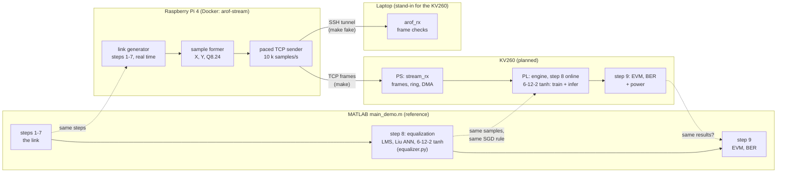
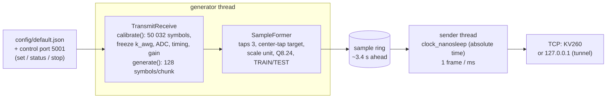
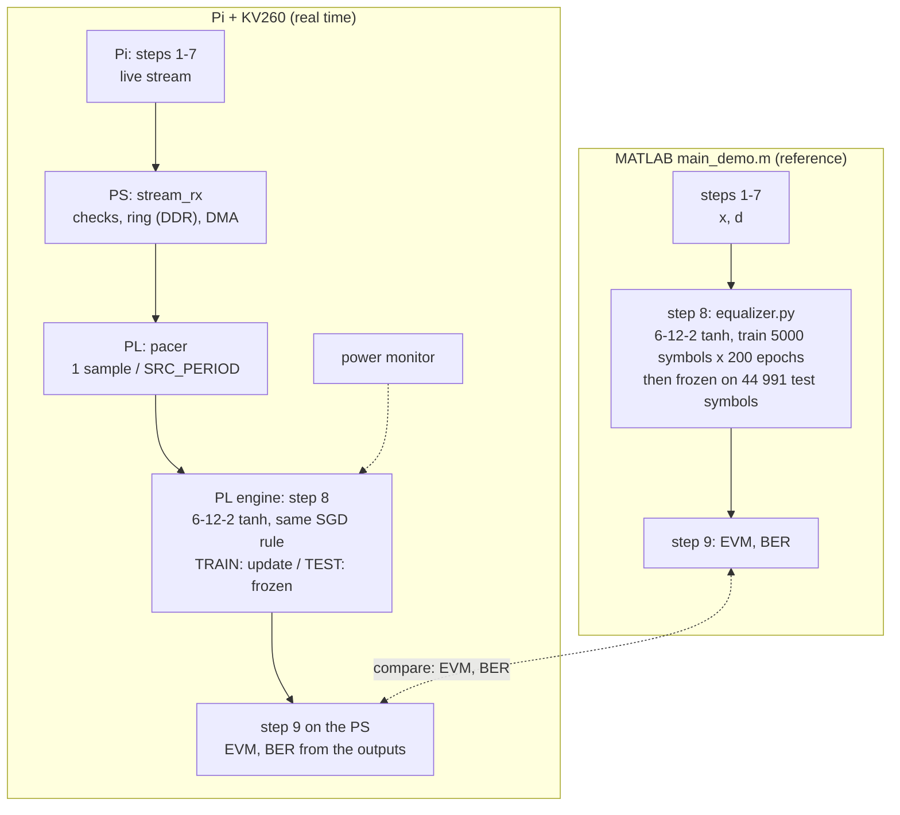
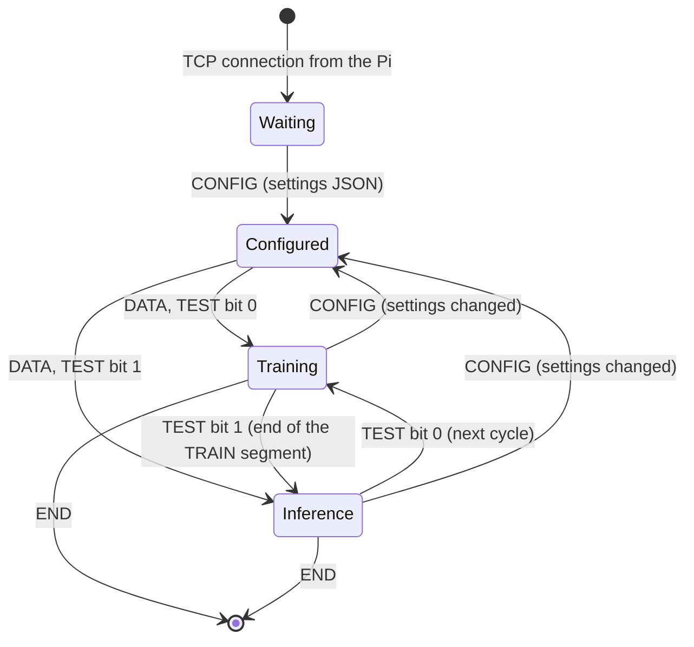

```mermaid
flowchart LR
    subgraph CO["Central office"]
        S["16QAM symbols<br/>0.4 GBd"] --> RRC["RRC shaping<br/>0.75 roll-off"] --> IF["IF 0.8 GHz<br/>AWG 300 mVpp"]
        IF --> DRV["driver amp<br/>G 24, Rapp"] --> MZM["MZM<br/>Vpi 4.4 V"]
    end
    subgraph FIB["Fiber"]
        F["15 km SMF<br/>dispersion"]
    end
    subgraph RAU["Remote antenna unit"]
        PD["photodetector<br/>heterodyne 60 GHz<br/>PD noise"] --> PA["RF amp<br/>AGC, Rapp"] --> RIP["RF response"]
    end
    subgraph AIR["Wireless"]
        W["1 m, FSPL 68 dB<br/>UE noise (LNA)"]
    end
    subgraph UE["User equipment + DSP"]
        DET["envelope detector<br/>square law, 1.5 GHz"] --> ADC["ADC 8 bit"]
        ADC --> DSP["down-convert<br/>matched filter<br/>timing, gain"]
    end
    MZM --> F --> PD
    RIP --> W --> DET
    DSP --> OUT["received symbols x(k)<br/>+ sent symbols d(k)"]
```

# Demo: the A-RoF link on the Raspberry Pi, equalized online on the KV260

`main_demo.m` does the whole experiment in MATLAB:
- **steps 1–7:** the 60-GHz analog radio-over-fiber link of Liu et al. (JLT 2017);
- **step 8:** the equalizers, with the neural networks trained by `matlab/equalizer.py`;
- **step 9:** EVM and BER.

This project runs the same experiment **in real time** on hardware: the data is generated live and
streamed. The receiver also captures it as datasets in the layout of `export_dataset.m`, which
MATLAB still exports for reference and offline processing (section 4).
- **The Raspberry Pi** runs steps 1–7 as an endless real-time stream. It turns each received
  16QAM symbol into a sample (inputs and target) and sends it over TCP to the KV260.
- **The KV260** does step 8 **online**, on the live stream: its engine trains the 6-12-2 tanh
  equalizer of the MATLAB study and equalizes the symbols as they arrive. Then it does step 9.
  The aims are to **reproduce the results of `main_demo.m`'s equalization (the Python chain) on
  the FPGA**, and to **measure the power** this takes.
- **A laptop** can stand in for the KV260.

This page shows how the parts connect:
- the link and its DSP chain;
- what the Pi does at each step, and which MATLAB step it mirrors;
- the frame format on the wire;
- what the KV260 does and how its results are compared with MATLAB.

The MATLAB demo itself is described in [reference/DEMO.md](../reference/DEMO.md). Step-by-step
details are in [matlab_mirror/](matlab_mirror/README.md), and measurements and decisions in
[STATUS.md](STATUS.md).

## 1. The system



| Part | Role | Status |
|---|---|---|
| MATLAB `main_demo.m` | The reference experiment: steps 1–7 (the link), 8 (equalizers, `equalizer.py`), 9 (EVM, BER) | Reference files in [reference/](../reference/) |
| Raspberry Pi, `arof_stream` in Docker | Runs steps 1–7 in real time, forms the samples, streams them at a fixed rate | Done (milestones 1–4); sample format to update (section 4) |
| Laptop, `host/arof_rx` | Receives through an SSH tunnel and checks every frame | Done |
| KV260, `stream_rx` + engine | Step 8 online on the live stream (train and infer the 6-12-2 tanh), step 9, power measurement | Planned (handoff section 11) |

## 2. The communication link and the DSP chain

The physical link of Liu et al.:
1. A central office drives a Mach-Zehnder modulator.
2. The optical signal crosses 15 km of fiber.
3. A remote antenna unit turns it into a 60-GHz radio signal.
4. The radio signal crosses 1 m of air to the user equipment.

The Pi simulates each block with the formula of the MATLAB module of the same name.



At 300 mV and −11.75 dBm:
- the CNR is 33.5 dB at the photodetector and 42.0 dB at the UE;
- the no-EQ EVM is 13.3 %.

About 12 % of that EVM is distortion, from the MZM, the chirp the fiber turns into intensity, and
the PA. An equalizer can partly undo it; the rest is noise.

## 3. The Pi's steps and their MATLAB counterparts

Every step uses the same logic and the same formulas as `main_demo.m`. The Pi differs only where a
stream has to:
- **Whole-sequence statistics:** where MATLAB takes a statistic over the whole sequence, the Pi
  measures it once on a calibration block of the same size and then freezes it.
- **Random numbers:** the Pi uses its own generator, so results agree statistically, not sample
  for sample.

| Step | MATLAB (`main_demo.m`, module) | Raspberry Pi (`src/`) | Difference on the Pi | Note |
|---|---|---|---|---|
| 0 Settings | `default_tx.m`, `default_link.m`, `experiment_setup.m` | `link/default_*`, `core/link_settings.*`, `config/default.json` | Settings live in JSON, changeable while streaming | [00](matlab_mirror/00_settings.md) |
| 1 Transmitter | `randi`, `qammod`, `upfirdn`, IF, AWG | `link/transmitter.*`, `core/comm.*` | AWG gain `k_awg` from the calibration block | [01](matlab_mirror/01_transmitter.md) |
| 2 Driver + MZM | `driver_amp.m`, `mzm.m` | `link/driver_amp.h`, `link/mzm.h` | None (memoryless) | [02](matlab_mirror/02_driver_mzm.md) |
| 3 Fiber | `fiber.m`, one FFT | `link/fiber.*`, overlap-save FFT | ±128-tap window: 2e-5 of the signal at 15 km | [03](matlab_mirror/03_fiber.md) |
| 4 Remote antenna unit | `photodetector.m`, `carrier_noise.m`, `rf_amp.m`, `rf_response.m` | `link/photodetector.*`, `rf_amp.*`, `rf_response.*` | One random stream per noise source | [04](matlab_mirror/04_remote_antenna_unit.md) |
| 5 Wireless hop | `wireless_hop.m` | `link/wireless_hop.*` | None | [05](matlab_mirror/05_wireless_hop.md) |
| 6 Detector + ADC | `envelope_detector.m`, `adc.m` | `link/envelope_detector.*`, `link/adc.*` | ADC range from the calibration block; out of range saturates | [06](matlab_mirror/06_detector_adc.md) |
| 7 Offline DSP | `conv`, timing search, LS gain | `link/receiver.*` | `mean(r)`, timing, gain from the calibration block | [07](matlab_mirror/07_offline_dsp.md) |
| 8 Equalization | `run_lms.m`, networks (`equalizer.py`) | **Not on the Pi**: done online on the KV260 (section 6) | `tools/run_lms.py` as an offline check | [08](matlab_mirror/08_equalization.md) |
| 9 Evaluation | `evaluate_outputs.m` | `core/evaluate_outputs.*`, `tools/evaluate_outputs.py` | Scores the calibration block only; on the KV260, scores the engine's outputs | [09](matlab_mirror/09_evaluation.md) |
| — The chain as a stream | `transmit_receive.m` | `link/transmit_receive.*` | Calibrate once, then generate forever | [10](matlab_mirror/10_chain_as_stream.md) |
| — Samples and streaming | Samples built in step 8 (`equalizer.py`) | `stream/*` | The samples as an endless TCP stream | [11](matlab_mirror/11_samples_streaming.md) |

Inside the container:



## 4. From received symbols to samples

Each received symbol becomes one sample, as soon as it is generated. The samples are exactly the
ones `matlab/equalizer.py` builds in `main_demo.m` step 8 for the network the hardware targets:
the 6-12-2 tanh of the MATLAB study (`own_tanh_6`: 3 taps, 12 hidden units, tanh, 2 linear
outputs).

```
X(n) = [ Re x(k)  Im x(k)  Re x(k-1)  Im x(k-1)  Re x(k-2)  Im x(k-2) ]   6 inputs: 3 received symbols, newest first
Y(n) = [ Re d(k-1)  Im d(k-1) ]                                         2 targets: the symbol sent at the center tap
```

- **Center-tap target:** the network predicts the middle symbol of its window
  (`delay = floor(taps/2) = 1`). It sees one symbol after the target and one before it, so it can
  undo interference from both sides. This is how `equalizer.py` trains every network of the
  study.
- **Scale "unit":** unit-power symbols, as `equalizer.py` uses for sigmoid and tanh networks. The
  16 targets are {±1, ±3}/√10. `grid` (×√10) stays available as a setting for the multilevel
  networks.
- **Q8.24:** each value as `nearbyint(float32(v) · 2^24)`, saturated to int32, the engine's
  number format. A sample is 8 words (32 bytes).
- **Taps setting:** with `taps = T`, a sample has `2T + 2` words and the target is
  `d(k - floor(T/2))`. `taps 2` (6 words) fits today's 4-12-2 engine.
- **Schedule:** sets which samples are TRAIN and which are TEST (section 6).
  - `demo` (default) follows `main_demo.m`: 5000 TRAIN samples (the first 10 % of 50 000
    symbols), then 44 991 TEST samples, repeating.
  - `train`: every sample is TRAIN, for pure online training scored prequentially. Periodic TEST
    blocks can be added when that experiment is designed.
- **The dataset:** one `demo` cycle, 49 991 samples (5000 train + 44 991 test), is the dataset
  of the project, in MATLAB and on the hardware. It is the training and test set of `main_demo.m`
  step 8, where the 6-12-2 tanh was shown to beat LMS (BER 5.6e-6 against 1.1e-5); 44 991 test
  symbols (180 000 bits) are needed to measure BER in that range. The receiver (`host/arof_rx`)
  saves each complete cycle in the layout of `export_dataset.m` (`dataset.mat`, train and test
  `.mem` files), and so does the Pi's `--record`.

## 5. The frame structure

One TCP connection, Pi → receiver, little-endian. Every frame starts with a 36-byte header
([src/stream/frame.h](../src/stream/frame.h)):

```
 0               4       6       8               12                              20
 +---------------+-------+-------+---------------+-------------------------------+
 | magic "AoRF"  |version| flags |      seq      |          first_sample         |
 | 0x46526F41    |   1   |       |  frame count  |   index of the first sample   |
 +---------------+-------+-------+---------------+-------------------------------+
 20              24      26      28              32              36
 +---------------+-------+-------+---------------+---------------+
 |   n_samples   |  wps  | rsvd  |   config_id   |     seed      |
 +---------------+-------+-------+---------------+---------------+
```

| Flag | Bit | Meaning |
|---|---|---|
| RECALIBRATED | 0 (1) | First data frame after a settings change |
| TEST | 1 (2) | The frame's samples are TEST: infer only, no weight update |
| END | 2 (4) | Last frame: the generator stopped |
| CONFIG | 3 (8) | The payload is JSON: the full settings and calibration |

Three kinds of frame:

```
CONFIG:  [header: flags 8, n_samples = JSON bytes, wps 0] [ JSON text ...................... ]
DATA:    [header: flags 0 or 2, n_samples 10, wps 8    ] [ sample 0: 8 words ][ sample 1 ] ... [ sample 9 ]
END:     [header: flags 4, n_samples 0                 ]
```

Each sample's 8 words:

```
 word:   0         1         2           3           4           5          | 6          7
         Re x(k)   Im x(k)   Re x(k-1)   Im x(k-1)   Re x(k-2)   Im x(k-2)  | Re d(k-1)  Im d(k-1)
         └──────────────────── X: network input ──────────────────────────┘   └── Y: target ──┘
 e.g.    FEF529E0  005D933F  FF1B6C57    FF2EFF5E    007D5E47    FF975A2C   | FF0D2317   FF0D2317
         -1.0423   0.3655    -0.8929     -0.8164     0.4897      -0.4088    | -0.9487    -0.9487
```

In this example the target, −3/√10 = −0.9487 on both I and Q, is the center tap, close to the
received value there, x(k−1) = −0.89 − 0.82j.

The stream in time (schedule `demo`, 10 k samples/s, 1 frame per ms):

```
 CONFIG  DATA DATA ... DATA | DATA ........ DATA | DATA ... DATA | DATA ........ DATA | ...   (CONFIG + RECALIBRATED
         └─ 5000 TRAIN ───┘ └─ 44 991 TEST ────┘ └─ 5000 TRAIN ┘ └─ 44 991 TEST ────┘        after a settings change)
         first_sample 0     5000                 49 991          54 991
         ◄─────────── cycle 0: about 5 s ──────► ◄─────────── cycle 1 ───────────►
```

- **No mixed frames:** a frame never mixes TRAIN and TEST samples, so the TEST bit applies to the
  whole frame.
- **Cycle boundaries:** `first_sample` is the generator's sample index, so the receiver finds where
  a cycle starts from the schedule's length, without a marker.
- **Settings changes:** a CONFIG frame opens every connection and announces every change. The
  first data frame after a change carries RECALIBRATED and the new `config_id`.

## 6. Step 8 online on the KV260: reproducing main_demo's equalization



### The reference: main_demo.m step 8

All the network results of the MATLAB study come from `matlab/equalizer.py`, in float64, called by
`core/run_network.m`. Its 'real' model trains with the engine's rule: per-sample SGD,
back-propagation with the pre-update weights, no restarts. `main_demo.m` step 8 trains every
equalizer on the first 10 % of a 50 000-symbol sequence and tests on the rest (44 991 symbols).
EVM and BER are reported together, because a staircase activation can lower EVM without reducing
the wrong decisions.

| Equalizer (one sequence, 300 mV, −11.75 dBm) | EVM | BER |
|---|---|---|
| No EQ | 13.3 % | 1.1e-4 |
| LMS FFE, 10 taps | 12.9 % | 1.1e-5 |
| Liu ANN (replicated) | 15.3 % | 6.1e-5 |
| **6-12-2 tanh (hardware target)** | 11.3 % | 5.6e-6 |
| 10-12-2 multilevel | 6.6 % | 1.1e-5 |

In the impairment study (validation data, 6 conditions × 3 runs), the 6-12-2 tanh had the best
mean BER of all candidates and beat LMS in most conditions. One sequence is not enough to claim
it beats the Liu replica; that comparison over 6 runs is still to be done in MATLAB.

### What the KV260 does, in real time

1. **Receive.** `stream_rx` on the PS checks the frames as they arrive, puts the samples in a ring
   in DDR and DMAs them to the PL.
2. **Pace.** A pacer releases one sample every `SRC_PERIOD` cycles: the exact clock comes from the
   PL, not from the network.
3. **Train and equalize.** The engine is the 6-12-2 tanh: 3 taps → 6 inputs, 12 hidden units,
   2 outputs. For each sample it computes its output and compares it with the target `Y`.
   - **TRAIN frame:** it updates its weights with the same SGD step as `equalizer.py`.
   - **TEST frame:** it does not update (inference only). Its output is the equalized symbol, and
     its error is a test error.
4. **Evaluate (step 9).** The PS reads the outputs and computes EVM and BER as
   `core/evaluate_outputs.m` does.
   - TEST outputs give the same numbers as `main_demo.m`'s test set.
   - Each TRAIN output is computed before the update on its own sample, so it also predicts an
     unseen symbol (prequential evaluation).

The Pi never equalizes: its output stops at step 7, as the KV260's input.

### Following main_demo.m's protocol on the live stream (schedule `demo`)

`main_demo.m` trains the 6-12-2 tanh for 200 epochs over its 5000 training symbols, about 1 M
updates, then freezes it for 44 991 test symbols. On the live stream:

- **Training.** The 5000 TRAIN samples arrive in real time (0.5 s at 10 k samples/s).
  `stream_rx` keeps them in DDR and replays them to the engine 200 times, as `equalizer.py` repeats
  its training symbols. Replay is unpaced, as fast as the engine trains (about 85 k updates/s, so
  about 12 s). The learning rate is 1e-2, as in the study.
- **Test.** The following 44 991 TEST samples are equalized live as they arrive, at the fixed
  clock, with the weights frozen, and are scored. Samples that arrive during the replay wait in
  the DDR ring (about 1.3 MB at 10 k samples/s for 12 s, far below the 16 MB ring).
- **Pure online training (schedule `train`).** Each new sample trains the engine once, with no
  replay, as a real receiver adapts. This is the next experiment, and its learning rate may need
  retuning.

### Comparing with MATLAB

1. **Statistical.** The Pi's random numbers differ from MATLAB's, so the board's EVM and BER are
   compared with `main_demo.m`'s over several seeds, within their spread.
2. **Engine arithmetic (later).** The engine works in Q8.24, `equalizer.py` in float64. Once
   `nn_training_model` has the 6-12-2 tanh (a tanh activation and a 6-input RAM map), it models
   the engine's arithmetic exactly. This is an important later step, before the RTL change.

### Power measurement

The KV260 also measures the power that real-time equalization takes:

| State | What runs |
|---|---|
| Idle | Bitstream loaded, no stream |
| Receiving only | `stream_rx`, DMA and pacer, engine idle |
| Training | Replay of the TRAIN samples, engine updating |
| Equalizing | Live TEST stream, inference at 10 k samples/s (and at higher rates) |

**Sources:**
- the board's own power telemetry, such as `xmutil platformstats` or the hwmon sensors (to
  confirm on the board);
- an external meter on the 12 V input, for the whole board;
- Vivado's post-implementation power report, as an estimate for the PL alone.

**Reported:** watts per state, plus energy per training update and per equalized symbol (power
divided by rate), each alongside the EVM and BER reached.

**Until the engine has the 6-12-2 tanh,** the stream can run with `taps 2` (6 words per sample)
for today's 4-12-2 sigmoid engine, to test the path and measure power.

## 7. The KV260 frame by frame

What the KV260 does with each frame it receives, as planned in the handoff (sections 5, 6, 11).
`stream_rx` on the PS reads every header; the engine in the PL sees only samples and a mode.



| Frame received | `stream_rx` (PS) | Engine (PL) |
|---|---|---|
| CONFIG | Parse the JSON: taps (8 words per sample for the 6-12-2 tanh, 6 for today's 4-12-2), schedule, rate → `SRC_PERIOD`, link settings; log the `config_id` | Nothing yet |
| DATA, TEST bit 0 (TRAIN) | Check `seq` and `first_sample`; samples into the DDR ring. Schedule `demo`: keep them and replay them 200 times. Schedule `train`: DMA → pacer directly | Forward pass, compare with `Y`, **update the weights**. The output, computed before the update, is a prequential test |
| DATA, TEST bit 1 (TEST) | As above, paced; set infer mode (`STREAM_CTRL`) for these samples; read the outputs for step 9 | Forward pass and error against `Y`, **weights frozen**: the equalized symbols, test EVM and BER |
| DATA with RECALIBRATED | Log the `config_id` change with the PROCESSED count: the channel changed here | Goes on training: the loss rises, then recovers (check V6) |
| END | Drain the ring, stop | Stop after the last sample |
| A gap in `seq` or `first_sample` | Count it: a valid run has none | — |
| The pacer has no sample when due | — | Count `UNDERRUN`: the Pi or the network fell behind |
| The engine is slower than the clock | — | Drop and count `DROPPED` (0 below about 80 k samples/s) |

## 8. How it mirrors MATLAB

The same experiment in two worlds: `main_demo.m` in MATLAB, and the Pi with the KV260 in real time.

| Stage | MATLAB (`main_demo.m`) | Pi + KV260 (real time) |
|---|---|---|
| Link, steps 1–7 | Inline in `main_demo.m` (= `link/transmit_receive.m`) | Pi: `src/link/*`, the same modules, generated live |
| Samples | Built by `equalizer.py` from x and d: 3 taps, center-tap target, unit power | Pi: `src/stream/sample_former.*`, the same samples, streamed |
| Number format | float64 | Q8.24, round half to even (Pi: `to_q8_24`) |
| Step 8, network | `equalizer.py`, 6-12-2 tanh, lr 1e-2 | The engine on the PL (6-12-2 tanh after the RTL change; 4-12-2 sigmoid today) |
| Step 8, protocol | Train 5000 symbols × 200 epochs, test 44 991 frozen | Schedule `demo`: the same on the live stream; `train`: pure online training |
| Dataset | `analysis/export_dataset.m` (reference, offline): 3 taps, center tap, unit power | Each `demo` cycle captured by `host/arof_rx` (and the Pi's `--record`): 49 991 samples in the same layout |
| Step 8, baseline | `core/run_lms.m` | `tools/run_lms.py` (offline check) |
| Step 9 | `core/evaluate_outputs.m`: EVM, BER on the test symbols | EVM, BER of the engine's TEST outputs (and prequential on TRAIN) |
| Engine arithmetic | — | `nn_training_model` (6-12-2 tanh: later step) |
| Power | — | Measured per state (section 6) |
| Settings change | A new run | A CONFIG frame + RECALIBRATED, without stopping |

## 9. Running it

On the Pi (`~/dev/arof-rt-generator`):

| Command | What |
|---|---|
| `make` | Build the image if needed, stream to the receiver in `config/default.json` (the KV260) |
| `make fake` | Stream to `127.0.0.1`, through the SSH tunnel to the laptop |
| `make status` | Is the streamer container up: uptime, CPU, memory, its last log lines |

On the laptop (`host/`):

| Command | What |
|---|---|
| `make` | Build `arof_rx`, open the SSH tunnel, receive 10 cycles (about 50 s), check every frame, save each cycle as a dataset, close the tunnel |
| `make CYCLES=60 DURATION=0` | 60 cycles (about 5 minutes) |
| `make verify` | Re-check the latest capture from its `stream.raw` |

Each capture (`host/captures/<time>/`) holds `stream.raw`, the samples and flags, and one
`cycle_NNN/` per complete cycle with `dataset.mat` (written with matio) and
`train_samples_q8_24.mem` (5000 samples) / `test_samples_q8_24.mem` (44 991).

## 10. How close the Pi is to MATLAB

| Check | Pi | MATLAB |
|---|---|---|
| No-EQ EVM, 300 mV, −11.75 dBm | 13.19 % | 13.21 % |
| Study points (ROP sweeps and impairments) | 74 of 74 within tolerance | `compare_results.mat`, `impairments_results.mat` |
| LMS on Pi samples vs MATLAB | 12.80 % | 12.81 % |
| Q8.24 words | Identical to the engine's conversion for the same values | |
| A recording exported in the layout of `arof_training_data.mat` (3 taps, center tap, unit) | Same fields, classes, columns, delay, scale; no EQ 13.27 %, LMS 12.86 % | Reference dataset: 13.38 %, 13.04 % |
| A received `demo` cycle against the Pi's `--record` | `.mem` files, samples and flags byte-identical; 5000 train + 44 991 test | |
| Stream received on the laptop, `demo` cycles | 13.26–13.29 % per cycle, no protocol errors | |
| 10 minutes in Docker | No gaps, rate error −0.00005 %, jitter 0.12 ms rms | |

The link checks (EVM, LMS, study points, streaming) were measured before the sample format
changed and don't depend on it; the sample checks above use the 3-tap, center-tap, unit-power
samples of section 4.
