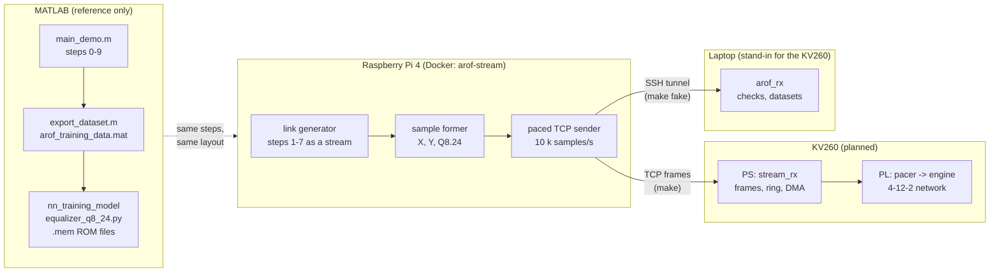
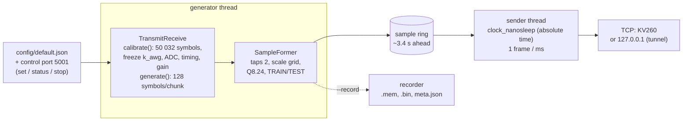
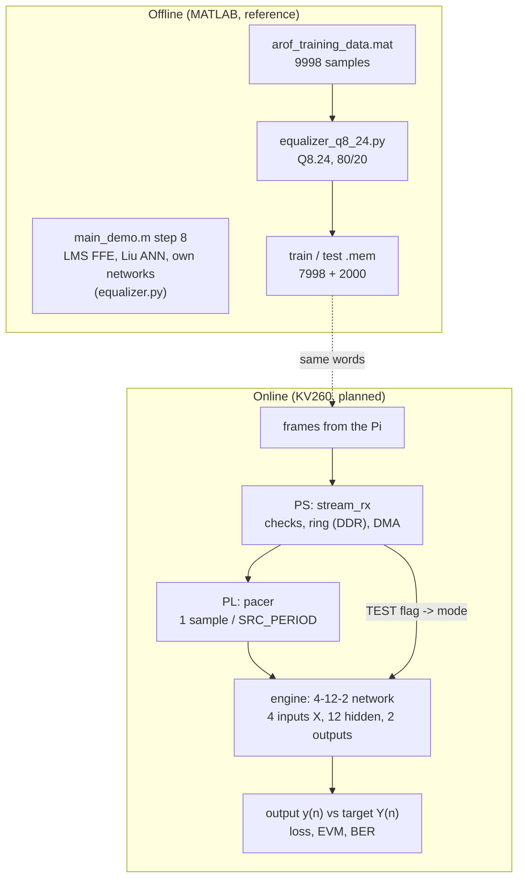
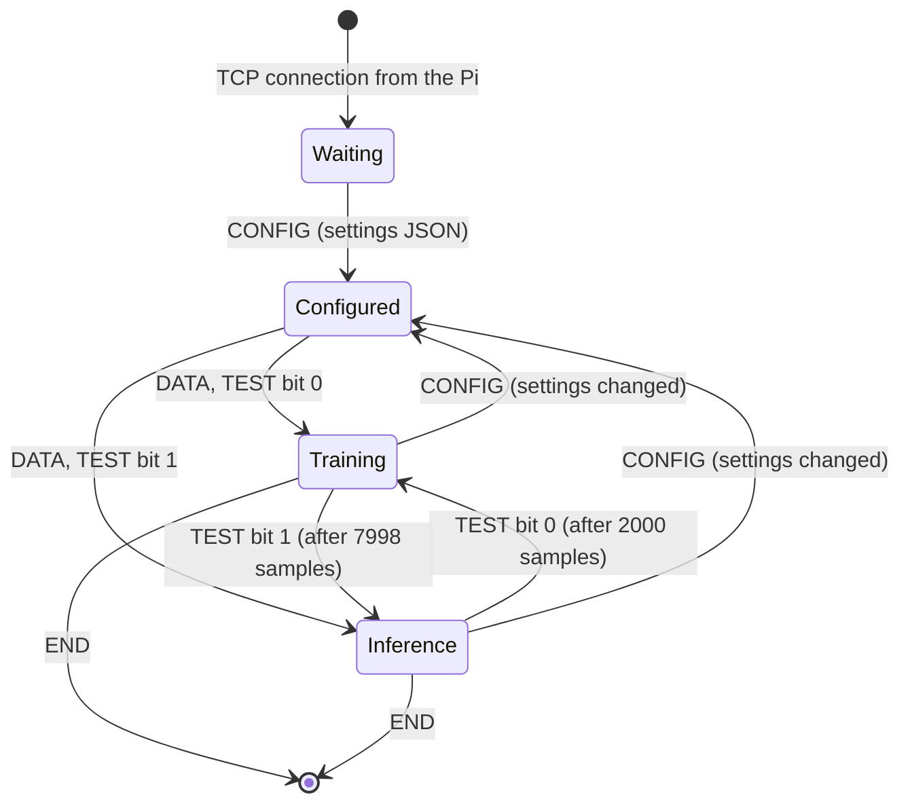

# Demo: the A-RoF link on the Raspberry Pi, from MATLAB to the equalizer

The Raspberry Pi runs the 60-GHz analog radio-over-fiber link of `main_demo.m` (Liu et al.,
JLT 2017) as an endless real-time stream. It turns the received 16QAM symbols into training
samples in the layout of `arof_training_data.mat`, and sends them over TCP to the KV260, whose
neural-network engine learns to equalize the link. A laptop can stand in for the KV260.

This page shows how the parts connect: the link and its DSP chain, what the Pi does at each step
and which MATLAB step it mirrors, the frame format on the wire, and where the equalizer comes in.
The MATLAB demo itself is described in [reference/DEMO.md](../reference/DEMO.md). Step-by-step
details are in [matlab_mirror/](matlab_mirror/README.md); measurements and decisions are in
[STATUS.md](STATUS.md).

## 1. The system



| Part | Role | Status |
|---|---|---|
| MATLAB `main_demo.m`, `export_dataset.m`, `nn_training_model` | the reference: the link, the dataset layout, the offline training | reference files in [reference/](../reference/) |
| Raspberry Pi, `arof_stream` in Docker | runs the link forever, forms the samples, streams them at a fixed rate | done: milestones 1-4 |
| Laptop, `host/arof_rx` | receives through an SSH tunnel, checks every frame, rebuilds the datasets | done |
| KV260, `stream_rx` + engine | receives, paces the samples into the PL, trains and infers | planned (handoff section 11) |

## 2. The communication link and the DSP chain

The physical link of Liu et al.: a central office drives a Mach-Zehnder modulator, the optical
signal crosses 15 km of fiber, a remote antenna unit turns it into a 60-GHz radio signal, which
crosses 1 m of air to the user equipment. The Pi simulates each block with the formula of the
MATLAB module of the same name.

```mermaid
flowchart LR
    subgraph CO["Central office"]
        S["16QAM symbols<br/>0.4 GBd"] --> RRC["RRC shaping<br/>0.75 roll-off"] --> IF["IF 0.8 GHz<br/>AWG 300 mVpp"]
        IF --> DRV["driver amp<br/>G 24, Rapp"] --> MZM["MZM<br/>Vpi 4.4 V"]
    end
    subgraph FIB["Fiber"]
        F["15 km SMF<br/>dispersion"]
    end
    subgraph RAU["Remote antenna unit"]
        PD["photodetector<br/>heterodyne 60 GHz<br/>PD noise"] --> PA["RF amp<br/>AGC, Rapp"] --> RIP["RF response"]
    end
    subgraph AIR["Wireless"]
        W["1 m, FSPL 68 dB<br/>UE noise (LNA)"]
    end
    subgraph UE["User equipment + DSP"]
        DET["envelope detector<br/>square law, 1.5 GHz"] --> ADC["ADC 8 bit"]
        ADC --> DSP["down-convert<br/>matched filter<br/>timing, gain"]
    end
    MZM --> F --> PD
    RIP --> W --> DET
    DSP --> OUT["received symbols x(k)<br/>+ sent symbols d(k)"]
```



At 300 mV and −11.75 dBm the link has a CNR of 33.5 dB at the photodetector and 42.0 dB at the
UE, and a no-EQ EVM of 13.3 %. About 12 % of it is distortion (the MZM, the chirp turned into
intensity by the fiber, the PA), which an equalizer can partly undo; the rest is noise.

## 3. The Pi's steps and their MATLAB counterparts

Every step uses the same logic and the same formulas as `main_demo.m`. The Pi differs only where
a stream has to: a statistic MATLAB takes over its whole sequence is measured once on a
calibration block of the same size and then frozen, and the random numbers are the generator's
own, so results agree statistically, not sample for sample.

| Step | MATLAB (`main_demo.m`, module) | Raspberry Pi (`src/`) | Difference on the Pi | Note |
|---|---|---|---|---|
| 0 Settings | `default_tx.m`, `default_link.m`, `experiment_setup.m` | `link/default_*`, `core/link_settings.*`, `config/default.json` | settings live in JSON, changeable while streaming | [00](matlab_mirror/00_settings.md) |
| 1 Transmitter | `randi`, `qammod`, `upfirdn`, IF, AWG | `link/transmitter.*`, `core/comm.*` | AWG gain `k_awg` from the calibration block | [01](matlab_mirror/01_transmitter.md) |
| 2 Driver + MZM | `driver_amp.m`, `mzm.m` | `link/driver_amp.h`, `link/mzm.h` | none (memoryless) | [02](matlab_mirror/02_driver_mzm.md) |
| 3 Fiber | `fiber.m`, one FFT | `link/fiber.*`, overlap-save FFT | ±128-tap window: 2e-5 of the signal at 15 km | [03](matlab_mirror/03_fiber.md) |
| 4 Remote antenna unit | `photodetector.m`, `carrier_noise.m`, `rf_amp.m`, `rf_response.m` | `link/photodetector.*`, `rf_amp.*`, `rf_response.*` | one random stream per noise source | [04](matlab_mirror/04_remote_antenna_unit.md) |
| 5 Wireless hop | `wireless_hop.m` | `link/wireless_hop.*` | none | [05](matlab_mirror/05_wireless_hop.md) |
| 6 Detector + ADC | `envelope_detector.m`, `adc.m` | `link/envelope_detector.*`, `link/adc.*` | ADC range from the calibration block; out of range saturates | [06](matlab_mirror/06_detector_adc.md) |
| 7 Offline DSP | `conv`, timing search, LS gain | `link/receiver.*` | `mean(r)`, timing, gain from the calibration block | [07](matlab_mirror/07_offline_dsp.md) |
| 8 Equalization | `run_lms.m`, networks | **not on the Pi**: the KV260's job | `tools/run_lms.py` as an offline check | [08](matlab_mirror/08_equalization.md) |
| 9 Evaluation | `evaluate_outputs.m` | `core/evaluate_outputs.*`, `tools/evaluate_outputs.py` | scores the calibration block only | [09](matlab_mirror/09_evaluation.md) |
| — The chain as a stream | `transmit_receive.m` | `link/transmit_receive.*` | calibrate once, then generate forever | [10](matlab_mirror/10_chain_as_stream.md) |
| — Samples and streaming | `export_dataset.m` (layout) | `stream/*` | the dataset as an endless TCP stream | [11](matlab_mirror/11_samples_streaming.md) |

Inside the container:



## 4. From received symbols to training samples

Each received symbol becomes one sample, in the layout of `export_dataset.m`, which is also what
`nn_training_model` feeds the engine:

```
X(n) = [ Re x(n)  Im x(n)  Re x(n-1)  Im x(n-1) ]     4 inputs: the newest symbol and the one before
Y(n) = [ Re d(n)  Im d(n) ]                           2 targets: the symbol that was sent
```

- **Scale "grid":** `x` and `d` times √10, so `Y` is exactly on the 16QAM grid {±1, ±3}.
- **Q8.24:** each value as `nearbyint(float32(v) · 2^24)`, saturated to int32, as
  `equalizer_q8_24.py`. A sample is 6 words (24 bytes).
- **Schedule `train_test`** (default): 7998 TRAIN samples, then 2000 TEST, repeating. This is
  the 80/20 split `nn_training_model` applies to a 9998-sample dataset; one cycle of the stream is
  one such dataset (1 s at 10 k samples/s).

## 5. The frame structure

One TCP connection, Pi → receiver, little-endian. Every frame starts with a 36-byte header
([src/stream/frame.h](../src/stream/frame.h)):

```
 0               4       6       8               12                              20
 +---------------+-------+-------+---------------+-------------------------------+
 | magic "AoRF"  |version| flags |      seq      |          first_sample         |
 | 0x46526F41    |   1   |       |  frame count  |   index of the first sample   |
 +---------------+-------+-------+---------------+-------------------------------+
 20              24      26      28              32              36
 +---------------+-------+-------+---------------+---------------+
 |   n_samples   |  wps  | rsvd  |   config_id   |     seed      |
 +---------------+-------+-------+---------------+---------------+
```

| Flag | Bit | Meaning |
|---|---|---|
| RECALIBRATED | 0 (1) | first data frame after a settings change |
| TEST | 1 (2) | the frame's samples are TEST: infer only, no weight update |
| END | 2 (4) | last frame: the generator stopped |
| CONFIG | 3 (8) | the payload is JSON: the full settings and calibration |

Three kinds of frame:

```
CONFIG:  [header: flags 8, n_samples = JSON bytes, wps 0] [ JSON text ...................... ]
DATA:    [header: flags 0 or 2, n_samples 10, wps 6    ] [ sample 0: 6 words ][ sample 1 ] ... [ sample 9 ]
END:     [header: flags 4, n_samples 0                 ]
```

Each sample's 6 words:

```
 word:   0         1         2           3          | 4        5
         Re x(n)   Im x(n)   Re x(n-1)   Im x(n-1)  | Re d(n)  Im d(n)
         └───────── X: network input ────────────┘   └─ Y: target ─┘
 e.g.    FF06C916  FCDA5E28  FCCCEB4C    FED67D2C   | FF000000 FD000000
         -0.9735   -3.1470   -3.1995     -1.1622    | -1.0     -3.0
```

The stream in time (10 k samples/s, 1 frame per ms):

```
 CONFIG  DATA DATA ... DATA | DATA ... DATA | DATA ... DATA | DATA ... DATA | ...   (CONFIG + RECALIBRATED
         └─ 7998 TRAIN ───┘ └─ 2000 TEST ─┘ └─ 7998 TRAIN ┘ └─ 2000 TEST ─┘        after a settings change)
         first_sample 0     7998            9998            17996
         ◄──────── cycle 0: 1 s ─────────► ◄──────── cycle 1 ──────────►
```

- A frame never mixes TRAIN and TEST samples, so the TEST bit applies to the whole frame.
- `first_sample` is the generator's sample index, so a cycle starts where
  `first_sample % 9998 == 0`; the receiver finds the boundaries without a marker.
- A CONFIG frame opens every connection and announces every change; the first data frame after a
  change carries RECALIBRATED and the new `config_id`.

## 6. The equalizer: offline and on the KV260



**Offline (MATLAB).** `main_demo.m` step 8 trains every equalizer on the first 10 % of a 50 000
symbol sequence and tests on the rest (44 991 symbols): LMS FFE 12.9 %, own 10-12-2 network
6.6 % EVM, against 13.3 % without EQ (reference/DEMO.md). For the hardware, `export_dataset.m`
writes a 9998-sample dataset and `nn_training_model` turns it into the Q8.24 ROM files of the
engine.

**Online (KV260, planned in the handoff, section 11).** The Pi's stream replaces the ROM files.

1. `stream_rx` on the PS checks the frames, stores them in a ring in DDR and DMAs them to the PL.
2. A pacer releases one sample every `SRC_PERIOD` cycles: the exact clock comes from the PL,
   not from the network.
3. The engine, a 4-12-2 network (2 taps → 4 inputs, 12 hidden units, 2 outputs; sigmoid,
   learning rate 1e-3 in the handoff), computes its output for each sample, compares it with the
   target `Y`, and:
   - **TRAIN frame:** updates its weights;
   - **TEST frame:** does not update (inference only), so its error is a test error.
4. Each output is computed before the update on its own sample, so even during TRAIN it predicts
   an unseen symbol (prequential evaluation). The EVM and BER come from these outputs.

The Pi never equalizes: its output stops at step 7, as the KV260's input.

**How it maps to MATLAB:** the network's input `X` is `rx_aligned` (MATLAB's received symbols `x`,
two taps), its target `Y` is `tx_aligned` (the sent `d`), and the TEST blocks play the role of
the test set: 2000 of each 9998 samples, as the engine's offline test ROM.

## 7. The KV260 frame by frame

What the KV260 does with each frame it receives, as planned in the handoff (sections 5, 6, 11).
`stream_rx` on the PS reads every header; the engine in the PL sees only samples and a mode.



| Frame received | `stream_rx` (PS) | Engine (PL) |
|---|---|---|
| CONFIG | parse the JSON: taps (must give 6 words per sample), rate → `SRC_PERIOD`, link settings; log the `config_id` | nothing yet |
| DATA, TEST bit 0 (TRAIN) | check `seq` and `first_sample`; samples into the DDR ring → DMA → pacer | forward pass, compare with `Y`, **update the weights**; the output, computed before the update, is a prequential test |
| DATA, TEST bit 1 (TEST) | as above; set infer mode (`STREAM_CTRL`) for these samples | forward pass and error against `Y`, **weights frozen**: the test EVM/BER |
| DATA with RECALIBRATED | log the `config_id` change with the PROCESSED count: the channel changed here | goes on training: the loss rises, then recovers (check V6) |
| END | drain the ring, stop | stop after the last sample |
| a gap in `seq` or `first_sample` | count it: a valid run has none | — |
| the pacer has no sample when due | — | count `UNDERRUN`: the Pi or the network fell behind |
| the engine is slower than the clock | — | drop and count `DROPPED` (0 below about 80 k samples/s) |

## 8. How it mirrors MATLAB and nn_training_model

The same data goes through the same stages in the three worlds: the MATLAB study, the offline
hardware flow of `nn_training_model`, and the real-time flow of the Pi and the KV260.

| Stage | MATLAB (`matlab/`) | `nn_training_model` (offline, ROM) | Pi + KV260 (online, stream) |
|---|---|---|---|
| Link, steps 1-7 | `link/transmit_receive.m` (inline in `main_demo.m`) | — (takes MATLAB's dataset) | Pi: `src/link/*`, the same modules |
| Dataset layout | `analysis/export_dataset.m`: X 9998×4, Y 9998×2, grid √10 | `equalizer_q8_24.py --dataset` loads it | Pi: `src/stream/sample_former.*`; laptop: `host/dataset.h` rebuilds the `.mat` |
| Fixed point | — | `fixedpoint.to_q` after a float32 cast: Q8.24, round half to even | Pi: `to_q8_24` (`sample_former.cpp`), byte-identical words |
| Train / test split | `train_frac` 0.1 of 50 000 symbols (study) | sequential 80/20: `train_samples_q8_24.mem` (7998), `test_samples_q8_24.mem` (2000) | the TEST flag: 7998 TRAIN + 2000 TEST frames per cycle |
| Feeding the engine | — | the ROMs, read in a loop (epochs over the same 7998 samples) | the paced stream: every sample new, one pass (online learning on an endless sequence) |
| Network | `core/equalizer_defs.m`, `core/run_network.m` → `equalizer.py` (Liu ANN, own tanh / multilevel networks) | the 4-12-2 engine model in Q8.24; golden files of loss, weights and outputs | the 4-12-2 engine on the PL; compared word for word with the golden files of the same recording (check V5) |
| LMS baseline | `core/run_lms.m` | — | `tools/run_lms.py` on a recording (offline check only) |
| Evaluation | `core/evaluate_outputs.m`: EVM, BER on the test symbols | test ROM after training | engine outputs on TEST frames (and prequential on TRAIN) |
| Settings change | a new run of the study | a new dataset | a CONFIG frame + RECALIBRATED, without stopping |

So a capture from the laptop (`host/`, one `cycle_NNN/` per cycle) is exactly what
`nn_training_model` expects: its `train_samples_q8_24.mem` and `test_samples_q8_24.mem` can go
into the engine's ROMs, and its `dataset.mat` into `equalizer_q8_24.py --dataset`, to compare the
offline training on one cycle with the online training the KV260 does on the stream.

## 9. Running it

On the Pi (`~/dev/arof-rt-generator`):

| Command | What |
|---|---|
| `make` | build the image if needed, stream to the receiver in `config/default.json` (the KV260) |
| `make fake` | stream to `127.0.0.1`, through the SSH tunnel to the laptop |
| `make status` | is the streamer container up: uptime, CPU, memory, its last log lines |

On the laptop (`host/`):

| Command | What |
|---|---|
| `make` | build `arof_rx`, open the SSH tunnel, receive 10 cycles into `captures/<time>/`, close the tunnel |
| `make CYCLES=60 DURATION=0` | 60 cycles (1 minute) |
| `make verify` | re-check the latest capture from its `stream.raw` |

Each capture holds `stream.raw`, `samples.bin`, `flags.bin`, the train/test `.mem` files,
`dataset.mat` (layout of `arof_training_data.mat`, written with matio), `configs.json`,
`summary.json`, and one `cycle_NNN/` dataset per complete cycle.

## 10. How close the Pi is to MATLAB

| Check | Pi | MATLAB |
|---|---|---|
| No-EQ EVM, 300 mV, −11.75 dBm | 13.19 % | 13.21 % |
| Study points (ROP sweeps and impairments) | 74 of 74 within tolerance | `compare_results.mat`, `impairments_results.mat` |
| LMS on Pi data vs MATLAB data | 12.80 % | 12.81 % |
| `.mem` words of a recording | byte-identical to `nn_training_model`'s for the same values | |
| Stream received on the laptop, 10 cycles | 13.17–13.35 % per cycle, no protocol errors | |
| 10 minutes in Docker | no gaps, rate error −0.00005 %, jitter 0.12 ms rms | |
